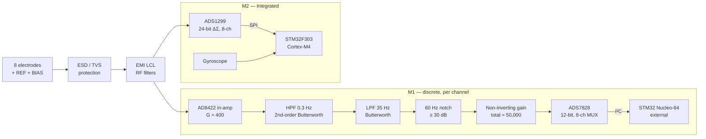
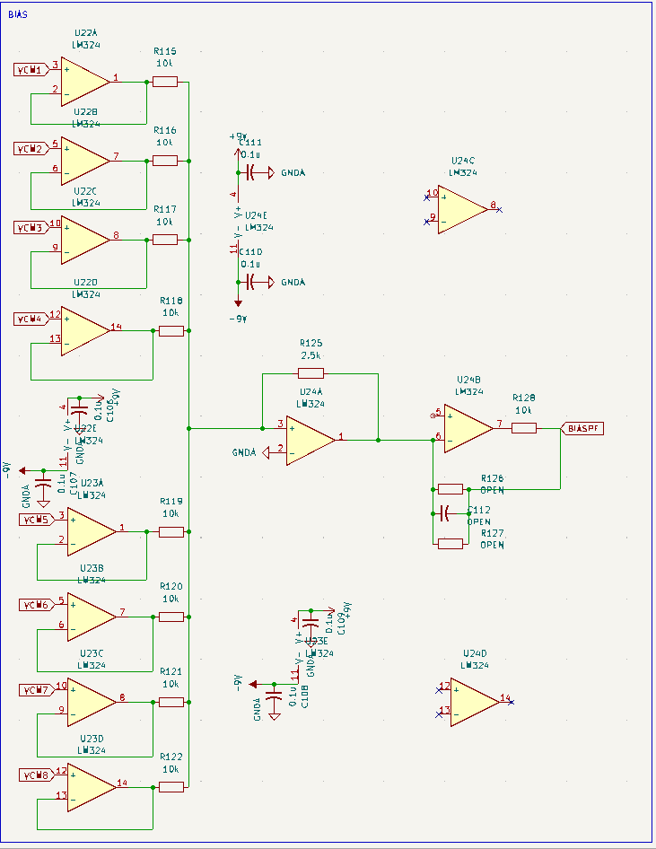
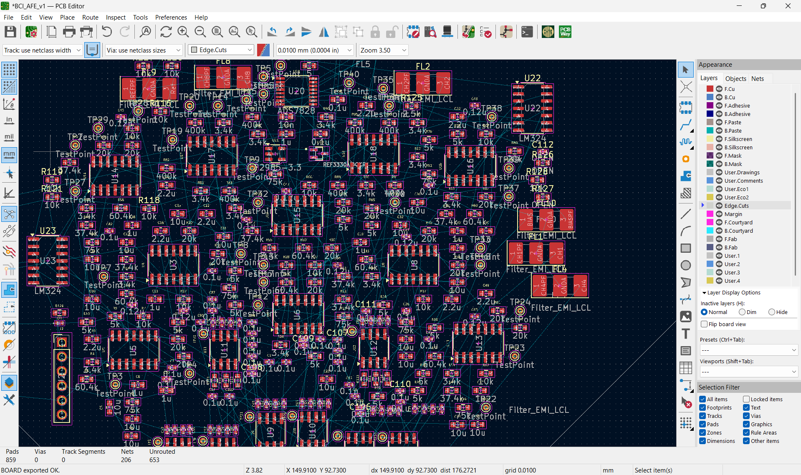
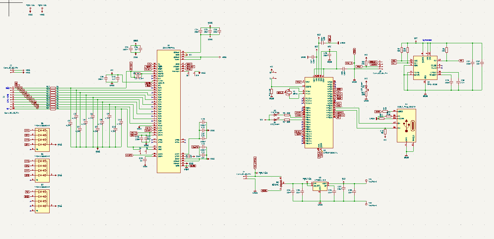

# 8-Channel EEG Brain–Computer Interface — Acquisition Hardware

Design of an **8-channel EEG acquisition system** for a brain–computer interface, explored in two hardware iterations:

- **M1, discrete analog front end:** each channel is built from discrete stages (protection, instrumentation amplifier, filters, gain), digitized by a 12-bit ADC and read by an external STM32.
- **M2, integrated front end:** a single **TI ADS1299** 24-bit biopotential ADC with an on-board STM32 and IMU, powered over USB.

Schematics and PCBs are designed in **KiCad**.

> 🧠 **Built on PolyCortex's open EEG work.** The M1 analog front end is based directly on the acquisition boards published by [**PolyCortex**](https://github.com/PolyCortex/AcquisitionEEG), a student neurotechnology society at Polytechnique Montréal. Their v2.2 and v3.0 designs define the signal-chain architecture, component choices and filter specifications that M1 follows. This repo adapts that design rather than claiming it as original. See [Acknowledgments](#acknowledgments--polycortex) for exactly what was adopted and what was changed.

> 🚧 **Status: work in progress.** Both schematics are complete. The M1 PCB layout is being routed, M2 is being prepared for fabrication, and the firmware is at an early polling stage. See [Roadmap](#roadmap).

> 📄 **Design report:** [`docs/BCI_Design_Report.pdf`](docs/BCI_Design_Report.pdf)

---

## System Overview



| | **M1 — Discrete AFE** | **M2 — ADS1299** |
|---|---|---|
| Channels | 8 | 8 |
| Conditioning | Discrete in-amp, filters and gain per channel | Integrated PGA in ADS1299 |
| ADC | ADS7828, 12-bit, I²C | ADS1299, 24-bit ΔΣ, simultaneous sampling |
| MCU | External STM32 Nucleo-64 | On-board STM32F303CCT (Cortex-M4) |
| Common-mode control | Discrete Right-Leg Drive | ADS1299 driven bias (BIASOUT) |
| Power | ±9 V batteries | USB |
| Extras | — | Gyroscope for head-motion data |

---

## M1 — Discrete Analog Front End

> **Design lineage:** this front end reproduces the PolyCortex acquisition chain (protection → in-amp → 0.3–35 Hz bandpass → 60 Hz notch → final gain, ±9 V supply, RLD and RF filtering from their v3.0 prototype), redrawn in KiCad and extended from 4 to 8 channels. Cutoffs match their published values, and gains are essentially the same: in-amp ≈ 398–400 and total ≈ 47,400–50,000.

### Signal chain (per channel)

| Stage | Implementation | Purpose |
|---|---|---|
| **ESD protection** | 3× TI TPD4E1B06 4-ch bidirectional TVS arrays | Protect the subject and circuit on all 8 channels, REF and BIAS |
| **RF filtering** | EMI LCL filter on every input line | Reject MHz–GHz interference from broadcast and wireless sources |
| **Instrumentation amp** | ADI AD8422, R<sub>G</sub> = 50 Ω → G ≈ 400 | Low-noise differential front-end gain with high CMRR |
| **High-pass filter** | 2nd-order Butterworth, f<sub>c</sub> = 0.3 Hz | Remove DC offset and slow drift artifacts |
| **Low-pass filter** | Butterworth, f<sub>c</sub> = 35 Hz | Remove EMG and high-frequency noise |
| **Notch filter** | 60 Hz, ≥ 30 dB attenuation | Suppress mains hum |
| **Final gain** | Non-inverting op-amp stage | Total simulated gain ≈ **50,000** to fit µV-level EEG into the ADC range |

### Right-Leg Drive

The common-mode voltage of each channel is buffered, summed and inverted (LM324), then driven back to the subject through the bias electrode. This actively cancels common-mode interference and raises the effective CMRR beyond what passive grounding achieves.

<p align="center">
  
</p>

### Power and digital

- **LP2985-3.3** LDO from the 9 V supply powers the ADC.
- **REF3330** precision 3.3 V reference sets the ADC's full-scale range.
- **ADS7828** 12-bit, 8-channel ADC with internal MUX and sample-and-hold, connected over I²C.
- The STM32 sits **off-board on purpose**, keeping digital switching noise away from µV-level analog signals.

<p align="center">
  
  <br><sub>M1 PCB in KiCad: SMD parts placed, routing in progress</sub>
</p>

---

## M2 — Integrated Front End (ADS1299)

M2 replaces the M1 per-channel analog chain with the **ADS1299**, the low-noise 24-bit simultaneous-sampling ΔΣ ADC also used in OpenBCI's Cyton board.

- **Referential montage:** every channel is measured against a common reference electrode using the ADS1299's internal routing, which cuts electrode cabling.
- **Driven bias:** the internal summing amplifier averages the common-mode signal from the selected electrodes, and the inverted signal is driven to the subject through **BIASOUT** via a protection resistor. BIASIN is the feedback point, not a measurement input.
- **On-board digital:** STM32F303CCT Cortex-M4, USB power, and a gyroscope for head-motion tracking.

<p align="center">
  
</p>

---

## Firmware (M1)

[`firmware/m1_stm32_ads7828/`](firmware/m1_stm32_ads7828) has an STM32 HAL driver that reads all 8 channels sequentially from the ADS7828. For each channel it sends a single-ended command byte with the external reference selected, reads two bytes, and rebuilds the 12-bit sample.

This is an early polling version. M2 firmware has not been started.

---

## Repository Layout

```
hardware/
  m1_discrete_afe/      KiCad project: schematic + PCB (in progress)
  m2_ads1299/           KiCad project: schematic + PCB
firmware/
  m1_stm32_ads7828/     STM32 HAL driver for the ADS7828
docs/
  BCI_Design_Report.pdf Design report
images/                 Figures used in this README
```

---

## Roadmap

- [x] M1 schematic: protection, AFE, filters, RLD, power, ADC
- [x] M2 schematic: ADS1299, STM32F303, IMU, USB power
- [x] ADS7828 I²C read driver
- [ ] Finish M1 PCB routing with mixed-signal practice: split analog/digital grounds, clean return paths, isolate the AFE from switching regulators
- [ ] Fabricate and bring up M2
- [ ] Move firmware from polling to interrupt/DMA-driven acquisition so no samples are lost
- [ ] Stream data to a PC for real-time visualization
- [ ] Mount in an OpenBCI Ultracortex headset

---

## Acknowledgments — PolyCortex

This project would not exist without **[PolyCortex](https://github.com/PolyCortex)**, the Polytechnique Montréal student society that openly documented its home-made EEG acquisition pipeline in **[PolyCortex/AcquisitionEEG](https://github.com/PolyCortex/AcquisitionEEG)**. Their write-ups, DipTrace schematics, LTspice simulations and component lists were the primary reference for M1. Thanks to the PolyCortex team and contributors, including Charles Bélanger Nzakimuena, and Alexandre Marcotte for the companion [PolyCortex GUI](https://github.com/AlexandreMarcotte/PolyCortex_Gui).

### Adopted from PolyCortex

| Element | PolyCortex design |
|---|---|
| Overall architecture | Discrete per-channel AFE: protection → in-amp → filters → final gain → ADC → MCU |
| Instrumentation amplifier | AD8422, gain ≈ 398 |
| Bandpass | 2nd-order Butterworth HPF 0.3 Hz + 2nd-order Butterworth LPF 35 Hz |
| Mains rejection | 60 Hz notch, ≈ −30 dB simulated |
| Final gain | Non-inverting op-amp stage, total gain ≈ 47,400 |
| Protection | TPD4E1B06 bidirectional TVS arrays |
| Supply | ±9 V from batteries, chosen to avoid op-amp saturation |
| Common-mode / EMI (v3.0 prototype) | Right-leg driver, RF filters on inputs |
| Components | LM324 op-amps, EMI filters, ADS7828 ADC (from their ADC test PCB) |

### Changed or added in this project

| Element | This project |
|---|---|
| Channel count | 8 channels (PolyCortex boards: 4) |
| EDA tool | Redrawn from scratch in **KiCad** (originals in DipTrace) |
| ADC | ADS7828 12-bit, 8-ch, I²C, used as the main acquisition ADC for all 8 channels |
| MCU | STM32 Nucleo-64 with a custom HAL driver (PolyCortex used an Arduino Uno R3) |
| Power for ADC | LP2985 3.3 V LDO + REF3330 3.3 V reference |
| M2 board | Separate ADS1299-based design with on-board STM32F303, IMU and USB power; not part of PolyCortex's work |

> PolyCortex's repository does not state a license, so **none of their original files are redistributed here**. All schematics and layouts in this repo were redrawn in KiCad, and anyone wanting the originals should get them from the [PolyCortex repo](https://github.com/PolyCortex/AcquisitionEEG).

The M2 design also draws on the **[OpenBCI](https://openbci.com)** Cyton board as a reference for ADS1299-based EEG acquisition, and the planned headset is OpenBCI's open-source **Ultracortex**.

---

## References

- PolyCortex, [AcquisitionEEG: acquisition PCB design files and documentation](https://github.com/PolyCortex/AcquisitionEEG), primary design reference for M1
- Texas Instruments, [ADS1299 datasheet](https://www.ti.com/lit/ds/symlink/ads1299.pdf)
- Texas Instruments, [SBAA188: Improving Common-Mode Rejection Using the Right-Leg Drive Amplifier](http://www.ti.com/lit/an/sbaa188/sbaa188.pdf)
- TI E2E forum, [ADS1299: testing bias / right-leg drive](https://e2e.ti.com/support/data-converters-group/data-converters/f/data-converters-forum/696153/ads1299-ads1299-testing-bias-right-leg-drive)
- [Sparky: testing and building](https://buildandcrash.blogspot.com/2013/05/sparky-testing-and-building-no-crashing.html)

---

**Author:** Armando Gordillo Ramírez. M1 analog front end adapted from [PolyCortex/AcquisitionEEG](https://github.com/PolyCortex/AcquisitionEEG).
